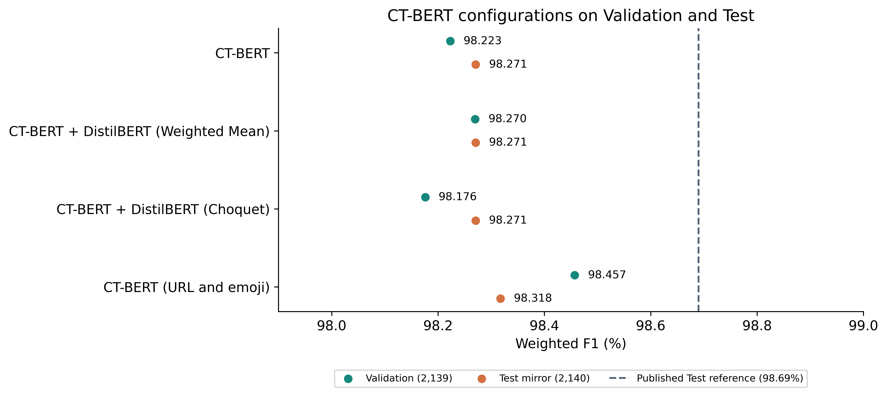

# COVID-19 Misinformation Detection

**98.32% weighted F1 on a 2,140-post CONSTRAINT 2021 test mirror.** This team coursework project compares classical text classifiers, graph models, transformer encoders, and probability ensembles. It includes a local Streamlit app for multi-model prediction, CSV batches, and LIME explanations.

[Results CSV](reports/20261124_ctbert_coursework/metrics_all_validation_test.csv) · [Analysis in Vietnamese](reports/20261124_ctbert_coursework/phan_tich_ket_qua.md) · [Streamlit guide](apps/coursework_v1/README.md) · [Team handoff](reports/20261124_ctbert_coursework/HUONG_DAN_CHIA_SE.md)



## Results at a glance

| Configuration | Validation weighted F1 | Test mirror weighted F1 | Test errors |
|---|---:|---:|---:|
| CT-BERT with URL and emoji preprocessing | **98.457%** | **98.318%** | **36** |
| CT-BERT | 98.223% | 98.271% | 37 |
| CT-BERT + DistilBERT, weighted mean | 98.270% | 98.271% | 37 |
| CT-BERT + DistilBERT, learned Choquet | 98.176% | 98.271% | 37 |

All four rows use calibrated probabilities. Validation has 2,139 posts after one verified exact Train duplicate was excluded. URL and emoji preprocessing reduced the number of errors by five on validation and one on the test mirror versus CT-BERT. The paired bootstrap interval for the test weighted-F1 difference spans zero. The two ensembles improved probability scores relative to the original CT-BERT while making the same total number of test errors.

Glazkova et al. reported **98.69%** on the official shared-task test set. This project used a previously used third-party test mirror with matching sample and class counts. Row-level equivalence with the official release was unverified. [Shared-task dataset](https://arxiv.org/abs/2011.03327) · [Published CT-BERT reference](https://arxiv.org/abs/2012.11967)

## Experiment design

- Fit models on 3,792 examples, select neural checkpoints on 702 separate inner-validation examples, fit sigmoid calibration on 642 examples, and fit ensemble parameters on another 642 examples.
- Use seed 42 and freeze checkpoints and learned parameters before evaluation. Record weighted and macro F1, per-class scores, MCC, log loss, Brier score, confusion matrices, and timings.
- Compare preprocessing variants under the same split. Report the limits of a single seed, known duplicate risk, and repeated use of evaluation data.

## Run the dashboard

From the repository root with Python 3.11:

```bash
python -m pip install -r apps/coursework_v1/requirements.txt
python -m streamlit run apps/coursework_v1/app.py
```

The overview uses the committed aggregate metrics. Local prediction requires the pinned checkpoints, tokenizers, calibrators, and lock files listed in [the model registry](apps/coursework_v1/model_registry.json), with CUDA for transformer inference. Those artifacts are distributed separately. The demo illustrates text classification and does not verify medical claims.

## Explore the project

| Path | Contents |
|---|---|
| [notebooks/](notebooks/) | Unified evaluation and the CT-BERT experiments |
| [src/](src/) | Training, evaluation, preprocessing, and release generation |
| [apps/coursework_v1/](apps/coursework_v1/) | Streamlit dashboard, inference, batch prediction, and LIME |
| [figures/presentation/](figures/presentation/) | Learning curves, confusion matrices, and calibration figures |
| [reports/20261124_ctbert_coursework/](reports/20261124_ctbert_coursework/) | Metrics, timing, paired analysis, and team notes |
